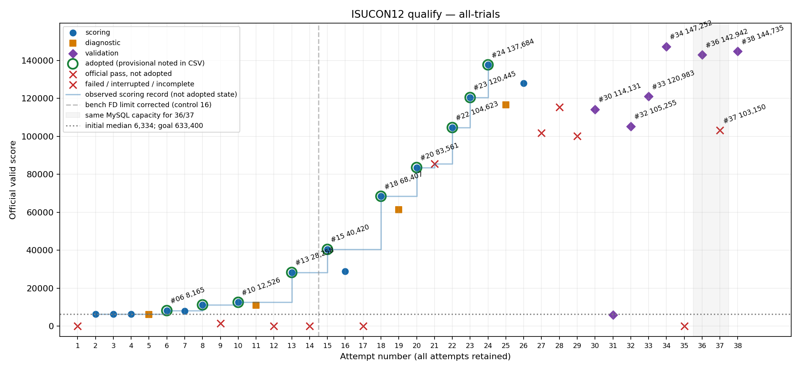
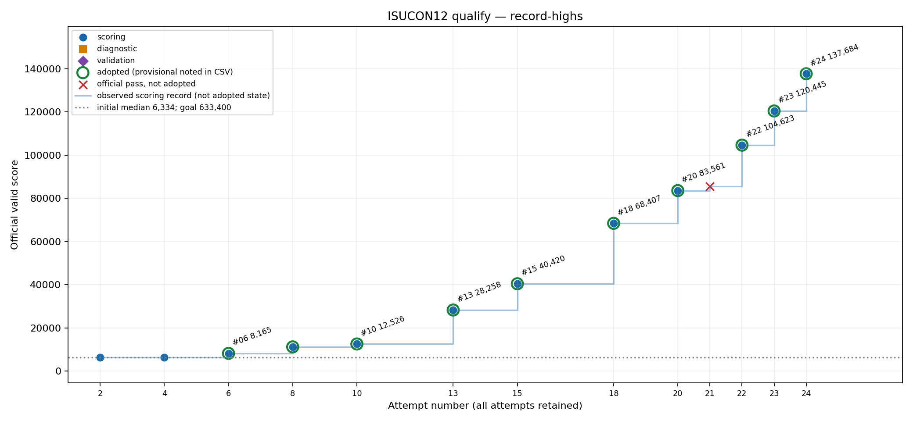

# ISUCON12予選 ローカル改善

[結果と検証](REPORT.md) · [全試行CSV](all-trials.csv) · [配備/再現手順](DEPLOY.md) · [仮説と採否](HYPOTHESES.md) · [最新状態](STATE.md)

[SQLiteからMySQLへの追試](MYSQL_EXPERIMENT.md): 同条件のSQLite142,942に対しMySQL103,150（約28%低下）、不採用。SQLiteへ復元後144,735・エラー0。

初期中央値6,334、途中のエラー0最高137,684（21.74倍）。100倍の目標633,400は未達。最終状態の再起動前後の検証値はREPORT.mdを参照。

全試行をresults/NNNに保持。ベンチ条件の変更、失敗、取り下げ、途中の最高値と最終検証を区別している。ISUCON12の講評・解説・参加記は参照していない。
