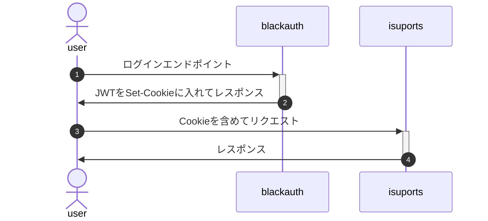

# ISUPORTSアプリケーションマニュアル

## ISUPORTSとは

社内ISUCONが普及した現代では、より多くのISUCONの結果をまとめられる利便性の高いリーダーボードアプリケーションが求められています。そのようなニーズに対して、ISUPORTSでは、会社ごとに隔離された高品質なISUCONリーダーボードを提供しています。
また利用料は明瞭です。大会を開いた分だけ、参加したチームの分だけ請求します。隠れた利用料は存在しません。
貴社もISUPORTSで社内ISUCONへのエンゲージメントを高めて、ISUCONによるベネフィットを得ましょう。

## 用語

### SaaS管理者(admin)
  - ユーザーアカウント種別のひとつ
  - テナントの追加、テナントを跨いだ支払い情報の確認を行う

### テナント(tenant)
  - SaaSを利用している団体

### テナント管理者(organizer)
  - ユーザーアカウント種別のひとつ
  - テナントの管理者
  - 以下の行動を行う
    - 大会の開催、終了、結果CSV入稿
    - 参加者の追加、失格
    - テナントの支払い情報確認

### 大会(competition)
  - テナント内に複数開かれる (ISUCONの大会)

### 参加者(player)
  - ユーザーアカウント種別のひとつ
  - テナントに登録される
    - テナント内の大会に参加可能な人たち
    - スコアを登録するとは限らない
  - 大会のスコア、ランキングの確認、テナント内の大会一覧の確認を行う

### 参加者の失格(disqualify)
  - テナント内の参加者の状態
  - テナント管理者が、参加者に対して行う
  - 失格になると参加者が確認できるAPIがすべて403になる

### 支払い情報
  - テナント毎に計算される

### 大会の結果の入稿
  - 大会主催者が、大会1つに対して行う
  - 参加者とスコアをペアにしたCSV
  - 大会を終了すると入稿できなくなる

### 大会の終了
  - 大会主催者が、大会1つに対して行う
  - 終了後は結果の入稿が出来ない

## 認証

ISUPORTSアプリケーションはCookie内に含まれているJWTを用いて認証を行います。ISUPORTSアプリケーション自体はJWTの発行機能を持ちません。代わりに、`blackauth` と呼ばれるJWT発行アプリケーションを用いています。

`blackauth` と ISUPORTSアプリケーションを用いた認証フローを以下の図に示します。

### blackauthのエンドポイント

`blackauth` は参加者,テナント管理者,SaaS管理者ごとに認証エンドポイントを持ちます。 
参加者とテナント管理者のログインエンドポイントは、それぞれが属するテナントのホスト名を指定します。SaaS管理者のログインエンドポイントは`admin.t.isucon.dev`をホスト名に指定します。

#### 参加者ログインエンドポイント

`POST https://<tenant name>.t.isucon.dev/auth/login/player?id=<player id>`

| パラメータ名 | 説明 |
|:---:|:---:|
| tenant name | 参加者が所属するテナントの`name` |
| player id | 参加者の`id` |

#### テナント管理者ログインエンドポイント

`POST https://<tenant name>.t.isucon.dev/auth/login/organizer`

| パラメータ名 | 説明 |
|:---:|:---:|
| tenant name | 参加者が所属するテナントの`name` |

#### SaaS管理者ログインエンドポイント

`POST https://admin.t.isucon.dev/auth/login/admin`